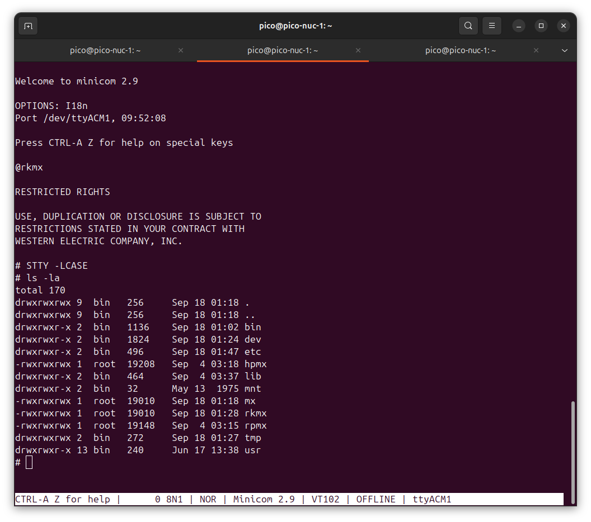
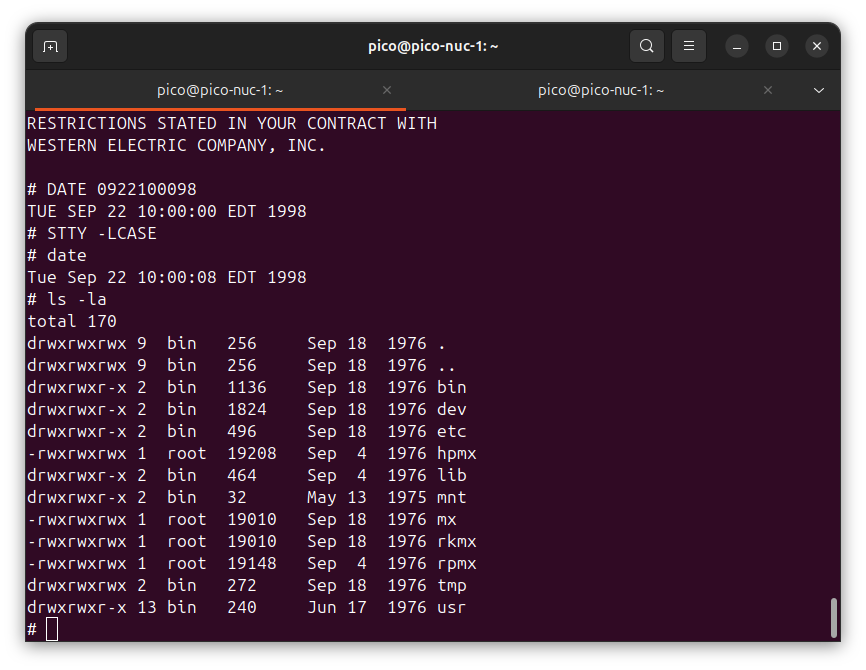

# PDP-11 (J-11) emulator for the Pico W and Pico 2 W

A DEC J-11 (KDJ11-BF) PDP-11 emulated on a Raspberry Pi Pico W (RP2040) or Pico 2 W (RP2350), written in PureMetal and built with PureMetal Forge. It boots Unix straight from the board's flash, displays its console on a supported panel, and keeps the USB serial console available: **Sixth Edition (V6) on the Pico 2 W and Mini-Unix on the Pico W.**

The emulated machine has a panel and USB serial console, an RK11 disk controller with an RK05 pack held in the board's flash, a KW11-L line clock and, on the J-11, memory management. The emulated processor runs alone on the chip's first core, with its hot run loop in SRAM; the second core does USB, the console, the disk's storage and the line clock's 60 Hz.



*Mini-Unix on a Pico W, seen in a terminal on Linux: the `@rkmx` boot, the licence notice, then a directory listing at the `#` prompt.*

- **How-to:** [docs/HOWTO.md](docs/HOWTO.md) (flashing, serial settings, booting, building)
- **Panels, live fonts and sound modules:** [OUTPUTS.md](OUTPUTS.md)
- **Firmware downloads and checksums:** [images/README.md](images/README.md)
- **Host tools:** [docs/TOOLS.md](docs/TOOLS.md)
- **Forum:** <https://forum.ajtaji.com>

## Current firmware: 2026-10-26

The ready-to-flash images now include the CPU optimizations, standard panel
console, and runtime TrueType fonts. LAFVIN ST7796 is the default screen on
both processors; Display Pack 2 ST7789, ILI9341 and HX8357D use the same
firmware with a small [screen settings UF2](images/output-settings/).
Only the LAFVIN glass has been checked in this update.

The additional assembly pass reduces measured Unix work time by 1.6% on
Pico W and 2.1% on Pico 2 W against the preceding firmware, with smaller
program images. Coverage and limits: [BENCHMARKS](docs/BENCHMARKS.md#additional-assembly-pass-2026-10-26).

Lato-derived Terminal Sans at 14 pixels is the default. The Pico rasterizes
the TrueType outlines itself and uses natural letter spacing. At the USB
console, press **Ctrl-]**, release it, then **f** to switch faces, **+** to
increase size, or **-** to decrease it. The guest keeps running. A monospace
face is included for aligned columns. Oversized requests are refused and
the previous font is restored.

Existing installations need only their board's **firmware.uf2**, not another
disk download. Full combined images are for installing the firmware and Unix
packs together. [Downloads, hashes and validation](images/README.md) list both.
All packaged builds use silent audio; the shared PCM interface supports an
optional Bluetooth backend or a custom output module ([details](OUTPUTS.md)).
The graphics demo runs on [RP2040](images/picow-demo/firmware.uf2) and
[RP2350](images/pico2w-demo/firmware.uf2). See [demo setup](OUTPUTS.md#graphics-and-sound-demo).

## Status per board

| | Pico 2 W (RP2350) | Pico W (RP2040) |
|---|---|---|
| Unix | Sixth Edition (V6) | Mini-Unix |
| Kernel booted | `rkunix` | `rkmx` |
| Memory management | on | off (Mini-Unix does not use it; the stats block says `MMU off (16-bit)`) |
| PDP-11 memory | 152 KB (000000-457777) plus the I/O page; V6 says `mem = 556` (56 KB, 000000-157777, with memory management off) | 56 KB (000000-157777) plus the I/O page |
| Speed, historical measurements on the boards (2026-10-20, with the hot paths in assembly) | V6 `time od /rkunix` in 10.4 s, timed from the host (13.9 s on 2026-10-04); the bench loop with memory management off ran at about 2,440,000 instructions per second on 2026-10-04 | Mini-Unix `time od /rkmx` in 4.6 s (5.9 s on 2026-10-04); the bench loop ran at about 2,550,000 instructions per second on 2026-10-04 |
| Console ready after port open (historical serial measurements) | `#` after 3.4 s | `#` after 3.2 s |
| RAM for writes | 112-block swap RAM disk plus 248 blocks for file-system writes in the standard panel build | 124 blocks shared by swap and file writes |
| Flash images | `combined.uf2` (one file) | `firmware.uf2` then `minix.uf2` (two files) |
| Disk | RK05 pack in flash, read-only | RK05 pack in flash, read-only |
| CPU-core diagnostic validation (2026-10-25) | 19 of 21 pass, including floating point; two expected J-11 model HALTs | 17 applicable integer tests pass; two expected J-11 model HALTs; no FP11 in this build |
| Seventh Edition (V7) | on the Pico Plus 2 W: `images/picoplus2-v7/combined.uf2`, boots itself ([Seventh Edition and floating point](#seventh-edition-v7-and-floating-point)) | not supported |

## Features

| Feature | Notes |
|---|---|
| J-11 (KDJ11-BF) processor | Run loop in SRAM on core 0; code left in flash runs through a 16 KB cache the two cores share |
| RK11 controller, RK05 pack | Pack held in the board's flash; on the Pico 2 W and the Pico W **the emulator never writes the flash** |
| RP11 controller, RP03 drive | PSRAM boards: V7's whole `/usr` on `/dev/rp3`, as V7 shipped it |
| Saving to flash | PSRAM boards (the V7 image): changes are saved by themselves a few seconds after the disks go quiet, or at once with Ctrl-] `w`, into a wear-levelled store that a power cut cannot spoil |
| KW11-L line clock | 60 Hz, kept by core 1 |
| Console | Panel output and USB serial; input remains on USB serial |
| Live TrueType fonts | Lato-derived proportional and JetBrains-derived monospace faces; Ctrl-] then f / + / - |
| Panel drivers | LAFVIN ST7796, Display Pack 2 ST7789, ILI9341 and HX8357D, selected by saved settings |
| Sound interface | Silent default, modular signed 48 kHz PCM, optional Bluetooth/custom sink |
| Auto-boot | Powers up into Unix with no typing; Esc within 2 s for the diagnostic console |
| Live statistics | Ctrl-] then `s` |
| Serial tape reader | Loads DEC diagnostic paper tapes over the serial port |
| Reflash without the button | Send `ResetPicoToBootSel1254` to the serial port |
| Host tools | Build your own disk image, patch V6 file systems, load tapes (see [docs/TOOLS.md](docs/TOOLS.md)) |

## Quick start

| Board | Flash | Runs |
|---|---|---|
| Pico 2 W (RP2350) | `images/pico2w-v6/combined.uf2` | Sixth Edition Unix (V6), memory management on |
| Pico W (RP2040) | `images/picow-mini-unix/firmware.uf2`, then `images/picow-mini-unix/minix.uf2` | Mini-Unix |
| Pimoroni Pico Plus 2 W | `images/picoplus2/combined.uf2` | Sixth Edition Unix (V6), 248 KB |
| Pimoroni Pico Plus 2 W | `images/picoplus2-v7/combined.uf2` | Seventh Edition Unix (V7), 2 MB, floating point, the whole `/usr`, saves to flash |
| Adafruit Feather RP2350 HSTX | `images/feather-v7/combined.uf2` | Seventh Edition Unix (V7), 2 MB, floating point, `/usr` on RK1, saves to flash |

1. Hold the board's **BOOTSEL** button while plugging it into USB. A drive appears (`RP2350` on the Pico 2 W, `RPI-RP2` on the Pico W).
2. Copy the UF2 file onto it. The board writes it and restarts by itself.
   - **Pico 2 W:** one file, `combined.uf2` (firmware and disk pack together).
   - **Pico W:** two files in two separate BOOTSEL sessions, firmware first, then `minix.uf2`. On the RP2040 a single combined file leaves the disk area unwritten (the start-up line then says `RK0: no pack`).
   - **With the PureMetal Forge IDE** instead of the button: choose the board in the **Board** menu and use **Compiler > Flash Prebuilt File...** with the same file(s); to change the firmware, open `diag.pico2` (or `diag.pico`) and **Compile + Upload**: the pack on the board is kept. See [docs/HOWTO.md, section 11](docs/HOWTO.md#11-flash-and-build-from-the-puremetal-forge-ide).
3. With the default panel enabled, Unix boots and displays its console without a serial terminal open. Open USB serial at 115200 8N1 for keyboard input or a second view (a COM port on Windows, `/dev/ttyACM0` or similar on Linux). With the `none` panel setting, the firmware waits up to 30 s for the serial port. The baud rate does not matter: it is USB.
4. The board boots Unix by itself. At `#` you are root; there is no login. Type in lower case (both systems print in capitals).

```
PDP-11 J-11 on Pico 2: serial tape reader ready
RK0: v6root, 4872 blocks, swap 4000-4871 in RAM, READ-ONLY: the flash is never written
auto-boot: RK0, switches 173030, then "rkunix" at the @ prompt. Press Esc within 2 s for the diagnostic console.
booting RK0, switches 173030
@rkunix
mem = 556
#
```

The full walk-through, with the console boot commands, setting the date and re-flashing without the button, is in [docs/HOWTO.md](docs/HOWTO.md).



*`date 0922100098` sets Tue Sep 22 10:00:00 1998 (month, day, hour, minute, two-digit year).*

## Pasting text

Text pasted into the terminal arrives all at once, far faster than any
terminal of the time could send. With the firmware before 2026-10-04 a
35-line, 620-character C program pasted into `cat >pn.c` lost most of its
text (measured in the emulator on the Pico 2 W build, V6), in two places:

- **In the USB serial library.** It keeps 256 characters and the console
  queue another 256. A paste longer than that overflowed the library's ring:
  128 of the 656 characters sent never reached the emulated machine.
- **Inside Unix.** Every character that did reach the PDP-11 was read by it
  (528 of 528; and 656 of 656 when the same text was sent a line every
  20 ms). But the console handed Unix the next character 100 instructions
  after the last, and V6 takes each one at interrupt level whether or not
  `cat` has had time to run. When its input queue reaches 256 characters it
  throws the whole queue away (`/usr/sys/dmr/tty.c`, `ttyinput`: `if
  (tp->t_rawq.c_cc>=TTYHOG) { flushtty(tp); return; }`). The file ended up
  with 4 bytes of 620 (131 at a line every 20 ms). At a line every 50 ms or
  slower the file was complete.

Both are fixed in the source:

- **The receiver has a pace.** The next character is given to the PDP-11
  2000 instructions after the last one was read, or at once when the
  processor is in a WAIT (Unix has nothing left to do). The rest waits.
- **The host is held back.** While the queues are full the firmware stops
  accepting USB packets, the host waits and sends again. This is USB's own
  flow control: nothing to set in the terminal.

**Measured on a Pico W** (Mini-Unix, `images/picow-mini-unix/firmware.uf2`,
2026-10-04): the same program sent in one write, and at 1000, 300, 100, 30
and 10 characters a second, read back with `od -c`: the file is byte for
byte identical every time (620 of 620). In the one-write case the host was
held back 3 times; every character sent was read by the PDP-11 and none was
lost. The stats block (Ctrl-] then `s`) has a `typed` line with these
counts.

**Measured on a Pico 2 W** (V6, `images/pico2w-v6/combined.uf2`,
2026-10-04): the same test, the same result - identical in one write and at
1000, 300, 100, 30 and 10 characters a second; the host was held back 4
times in the one-write case, and nothing was lost.

What remains is Unix's own, on any PDP-11:

- A single line longer than 255 characters is thrown away (the same
  `TTYHOG` test: Unix only hands a line to the program at its end).
- `#` erases the character before it and `@` erases the line, as on every
  V6 terminal. Type `\#` and `\@` to enter them, or change them with
  `stty`.
- While the terminal is in upper-case mode (the images' default) capitals
  are stored as lower case. `stty -lcase` first.
- On the Pico W the RAM for disk writes is 124 blocks (Known limits,
  below): what you paste into a file uses it until the next power-up.

## PSRAM boards

**State of the source now (2026-10-07).** The PSRAM boards' firmware has **22-bit memory management and 3812 KB of PDP-11 memory** (00000000-16707777: 56 KB in SRAM, 3756 KB in PSRAM), the Unibus map of a PDP-11/84 and the RK11 through it. V6's own 11/70 kernel, built on a board from the distribution's sources (`docs/psram/build-rk70unix.txt`), boots there and prints `mem = 18857`. **V6 prints that figure in tenths of 1024 words: 18857 is 3771 KB free of the 3812 KB** (the 18-bit kernel's `mem = 1036` is 207 KB free of 248 KB). That kernel lives in PSRAM only: a reset puts the pack back as the flash holds it, and putting the kernel into the pack image is not done yet. The tools for it ([docs/TOOLS.md](docs/TOOLS.md): `od2bin.py`, `v6fs.py put`) have since done exactly that for Mini-Unix's kernel (2026-10-20, [docs/minix/](docs/minix/)), but not yet for this one. RK1 is stored as 4000 blocks, the size of the V6 source pack's file system; blocks 4000 to 4871 of RK1 answer with a drive error.

Two things changed after the runs recorded below, both run on the Feather on 2026-10-07:

- **The packs moved in the flash** to keep clear of the region a board with a radio keeps its radio firmware in: the program is below 0x10200000, 0x10200000 to 0x1023FFFF is never used, RK0 is at 0x10240000 and RK1 at 0x104C0000 (one file, `J11_18MHz_KDJ11_BF/pico2/flash_layout.pico2`). Installed on the Feather with `tools/pack_install.py`: the file, the installer and the firmware's start-up line all give `RK0 21C285A3 5CA82BF0 RK1 1215D2AC 967B3EC6`. The Pimoroni moved too (2026-10-20): `images/picoplus2/combined.uf2` is now a build of the current source, run on a Pico Plus 2 W. `images/feather/combined.uf2` followed on 2026-10-22: a build of the current source, run on a Feather.
- **The PDP-11's memory is first in the PSRAM**, before the two packs. With it behind the packs the 22-bit firmware took 13.35 s for `time od /rkunix >/dev/null` where the 248 KB firmware took 13.08 s; with the memory first it takes 13.08 s (Feather, the 18-bit kernel, timed from the host, two runs each, one compiler build). The reason is in `pico2/psram_pdp11.pico2`.

The table and the lines below are the record of the 248 KB firmware of the same day (the boards' transcripts are in [docs/psram/](docs/psram/), the 22-bit ones included).

Two boards with 8 MB of QSPI PSRAM run V6 with **248 KB of PDP-11 memory** (V6 prints `mem = 1036`, against 76 on the Pico 2 W), both RK05 packs writable in PSRAM with the whole swap area, and the flash never written. Both ran on 2026-10-07; the images are in [images/](images/README.md) and the transcripts in [docs/psram/](docs/psram/). The Pimoroni's image was rebuilt on 2026-10-20 from the current source (22-bit memory, the hot paths in assembly) and run on a Pico Plus 2 W: with the 18-bit kernel `mem = 1036`, `time od /rkunix >/dev/null` in 10.44 s, `cc`, RK1 and DFKAA, DFKAB, DFKAC as below ([images/README.md](images/README.md)).

| | Pimoroni Pico Plus 2 W | Adafruit Feather RP2350 HSTX |
|---|---|---|
| Chip, PSRAM chip select | RP2350B, GPIO47 | RP2350A, GPIO8 |
| Flash (JEDEC ID read on the board) | Winbond W25Q128JV, 16 MB (EF 40 18) | Winbond W25Q64JV, 8 MB (EF 40 17) |
| Image | `images/picoplus2/combined.uf2` | `images/feather/combined.uf2` |
| V6 start-up | `mem = 1036` | `mem = 1036` |
| `time od /rkunix >/dev/null`, timed from the host | 13.08 s | 13.08 s |
| `cc` of a small C file | 3.5 s | 3.5 s |
| Packs copied from flash into PSRAM at start-up | 1258 ms | 1258 ms |
| DEC diagnostics DFKAA, DFKAB, DFKAC | 3 of 3 pass | 3 of 3 pass |

What a board prints at start-up:

```
PSRAM: 8 MB on GPIO47, ID 0D 5D 53, clock 75000 kHz; packs copied and checked in 1258 ms (copy 903, check 330); memory 248 KB; RK0 and RK1 (4000 blocks) writable in PSRAM, never written to flash; the PSRAM copy's kernel patch applied (block 1517 +90)
PSRAM windows: packs uncached, memory cached
pack checksums: RK0 21C285A3 5CA82BF0 RK1 1215D2AC 967B3EC6
RK0: v6root, 4872 blocks, running from its PSRAM copy: writable, every write lost at power-off, the whole swap area (4000-4871); the flash is never written
```

- **What V6 gains:** the C compiler runs (`cc`), `/etc/mount /dev/rk1 /usr/source` mounts V6's source pack, and twelve 30 KB processes stayed alive at once with seven swapped out. The V6 image's firmware (2026-10-22) saves the changes to flash by itself, as the V7 image's does ([Seventh Edition](#seventh-edition-v7-and-floating-point)).
- **The chip is set up by the compiler's own library** (`RP2350/Lib/psram.pico2`); `pico2/psram_pdp11.pico2` holds what the PDP-11 does with the memory.
- **A program in PSRAM runs as fast as one in SRAM.** The memory management unit's fast windows hold a host address for each page, in SRAM or in PSRAM alike. Before that change the same `od` job took 46.2 s with the program in PSRAM.
- **Which window, measured on V6 itself:** the PDP-11's memory goes through the XIP cache (13.08 s for the `od` job; 18.56 s through the uncached window); the packs go through the uncached window, so a block transfer evicts nothing.
- **If the PSRAM is not found**, or is not a working 8 MB chip, the pin is given back and the board runs as the Pico 2 W build does (the pack read-only in flash; then 56 KB, `mem = 76`), and the first line says why. Shown on a board by building the Pimoroni image with the Feather's pin: `PSRAM: not in use - the PSRAM library found none (its error 5: no chip answered the ID read on this pin). Running as the Pico 2 build: 56 KB, the pack read-only in flash.` A 4 MB chip and a chip that fails its test could not be shown on these boards; `tools/psram_desk_check.py` covers them on the emulator and has not been run again since the firmware moved to the library.
- **Getting it onto a board:** copy `combined.uf2` to the board's boot drive (hold BOOT while plugging in), or, with no button and no drive, send the packs over USB serial with `tools/pack_install.py` and upload the firmware with the compiler: [docs/HOWTO.md, section 10](docs/HOWTO.md#10-the-psram-boards). The boards here were loaded the second way; the firmware and pack bytes on them are the ones in the image files (the firmware's SHA-256 and the pack checksums were compared), but the files themselves were not copied to a boot drive.

## Seventh Edition (V7) and floating point

On the PSRAM boards the machine has the J-11's floating point unit and 2 MB for V7. `images/picoplus2-v7/combined.uf2` boots V7 by itself to its single-user `#` (the firmware gives it 2040 KB and answers its two boot prompts); Ctrl-D goes multi-user, where root logs in with no password and `/usr` is mounted from an emulated RP03 - the distribution's whole `/usr`: sources, documents, the dictionary, the games, the libraries and the manual. `cc` (floating point included), `awk`, `dc`, `adb`, `ps`, `man` work. What Unix writes is saved to the flash by itself a few seconds after the disks go quiet (Ctrl-] `w` saves at once) and is there at the next power-up. `tools/v7_pack.py` builds the disks from the distribution tape in `media/unix/` ([docs/HOWTO.md, section 12](docs/HOWTO.md#12-seventh-edition-v7-on-the-pico-plus-2-w)).

Measured on a Pico Plus 2 W on 2026-10-21 ([docs/BENCHMARKS.md](docs/BENCHMARKS.md)):

| Benchmark | V7 | V6 |
|---|---|---|
| Dhrystone 2.1 | 1,125.7 Dhrystones/s (0.64 DMIPS) | - (needs `typedef` and `enum`) |
| Whetstone, double precision | about 183 KWIPS | about 227 KWIPS |
| BYTE Sieve, 10 iterations | 2.5 s | 2.5 s (the Pico 2 W too) |
| givens (pichart), double precision | 85,000-104,000 FLOPS | - |

For comparison, a PDP-11/70 with its FP11 ran the double precision Whetstone at 479 under DEC's FORTRAN-IV-PLUS, and the Sieve in C under Unix V6 in **1.52 s**, as recorded in [BYTE January 1983, table 1, page 298](https://calentamientoglobalacelerado.net/benchmarkzone/download/criba_sieve_byte_1983.pdf). Against another PDP-11 emulator on the same board and clock (Pico_1140, the same V6 and the same benchmarks), this one is 1.25 to 2.7 times as fast: [docs/COMPARISON.md](docs/COMPARISON.md).

## Known limits

- **PDP-11 memory:** 152 KB on the Pico 2 W (V6 reports `mem = 556`: about 111 KB for user programs), 56 KB on the Pico W. Until 2026-10-21 the Pico 2 W had 56 KB too (`mem = 76`, 15 KB for programs): its run loop for memory management off took 256 KB of SRAM for a table, now 32 KB.
- **Writes live in RAM (RAM disks), in 512-byte blocks.**
  - Pico 2 W: a **swap RAM disk of 112 blocks** (56 KB, blocks 4000-4111 of the pack) and **254 blocks (127 KB) for file-system writes**. The V6 kernel in the image is patched to swap only there (`_nswap` = 112), so swap can never be refused. 112 blocks hold about three of V6's largest processes (about 33 blocks each) or many small ones; if a session ever needs more, V6 stops with its own "panic: out of swap space".
  - Pico W: a **63 KB lossless compressed RAM overlay**, with raw fallback and 255 unique records. Identical blocks can share storage; an empty pool holds at least 125 incompressible blocks. Capacity remains finite and depends on the data. Replacement refuses cleanly when full, preserving previous writes. The current Mini-Unix kernel uses process slots consistently for swap, exit and wait, and provides a real pipe system call. See [the kernel and overlay guide](docs/minix/j11-pipes.md).
  - When the file-write blocks are used up, a write to a new block fails: Unix sees a disk error, the console prints once `[RK0: the RAM overlay for file writes is full ...]`, and the statistics block shows `FULL: n writes refused`. Nothing already written changes and nothing reaches the flash; power off to start clean.
- **Saving across a power cycle: the PSRAM boards' images only.** On the Pico 2 W and the Pico W every disk write, the swap area included, goes to RAM and the next power-up starts from the pack as flashed; `sync` saves nothing there. The Pico Plus 2 W images (V6 and V7) and the Feather's (V6) save the changes into the top 1 MB of the flash, by themselves or with Ctrl-] `w`, never over what they already hold, with the erases spread over the store's 256 sectors (HOWTO section 12, Saving). The swap area is never saved.
- **V6 on the Pico 2 W:** `ps` works; `df` with no argument looks for V6's built-in `/dev/rk2` and `/dev/rp0`, which this machine does not have, so type **`df /dev/rk0`**. `cc` and `dc` run (both needed more memory than the 56 KB the machine had before 2026-10-21).
- **Seventh Edition (V7) runs on the PSRAM boards only** (`images/picoplus2-v7/combined.uf2` for the Pico Plus 2 W, `images/feather-v7/combined.uf2` for the Feather RP2350 HSTX; the Pico W has 56 KB). On the 152 KB Pico 2 W it boots and runs (`v7_pack.py --pico2w`, HOWTO section 12) until its RAM for writes fills, after two or three compiles: not shipped as an image. On the Pico Plus 2 W its `/usr` is the whole distribution `/usr` on the RP03's `/dev/rp3`, a 20,800-block file system with about 1.9 MB free; the Feather's 8 MB of flash cannot hold that, so its `/usr` is RK1's 4,000 blocks: the libraries, nroff's macros, the manual and the headers, without the sources, `/usr/doc`, the dictionary and the games. `df` lists both disks. `date` takes a year from 00 to 99, 00-69 being 2000-2069.
- **Packs:** RK05 (up to 4872 blocks), drive 0 only (RK1 as well on the PSRAM boards), and on the PSRAM boards one RP03 in RK1's place for V7's `/usr`. On the RP2350 boards the pack starts at 0x10240000, so the Pico 2 W's 4 MB hold 1.75 MB of pack: the V6 root pack is stored mapped (2,891 blocks in use). `images/pico2w-v6/combined.uf2` is that build; it ran on a Pico 2 W on 2026-10-20.
- **The Pico W image uses the flash where the radio's firmware would go; a Pico W running it cannot use its radio.** Its 2 MB cannot hold Mini-Unix (3,061 blocks in use) clear of that region; the firmware says so at start-up and `tools/rk_image.py` when it packs. The Pico W image of 2026-10-20 ran on a Pico W.
- **Mini-Unix:** a refused swap write can restart the shell.
- **Year 2000:** the `date` command takes a two-digit year; V6's and Mini-Unix's read it as 19yy, V7's (rebuilt on a board) 00-69 as 20yy.

## The emulated processor, and where it is known to differ from a real J-11

The processor is a J-11 as far as the software run on it needs: the instruction set, with the FPJ11 floating point unit on the RP2350 builds (the Pico W has none: its floating point instructions trap as reserved), the three modes, memory management with 18-bit and 22-bit mapping, the CPU error and maintenance registers, and on the PSRAM boards the Unibus map of a PDP-11/84. It boots the Unix systems named above and passes the diagnostic ladder as [media/diagnostics/ladder.txt](media/diagnostics/ladder.txt) states it. **It is not claimed to be an exact KDJ11.** No diagnostic written for the KDJ11 has been run on it (none is in the diagnostic image here); the diagnostics that have been run are for other processors (the 11/20 family, the 11/34, the 11/44, the F-11 of the 11/23), judged against the published manuals.

One behaviour was corrected from those runs: with a register as the source and memory as the destination, the register is read after the destination's address has been worked out, so `MOV R0,(R0)+` stores R0 already stepped and `MOV PC,X(R)` stores the address of the instruction plus 4 (KDJ11-A CPU Module User's Guide, EK-KDJ1A-UG-002, appendix B, table B-1, items 1 to 3). The F-11 CPU diagnostic CJKDBD0 halted at its test 264 before the change and runs to its test 405 after it; the 11/34 diagnostic DFKAA tests the 11/34's opposite behaviour in its test 145 and carries two patches in the ladder for that reason.

Known differences, found by those tapes and left as they are:

- **MMR0 after a reference in the illegal processor mode (10):** the emulator sets bits 15 and 14; a J-11 sets bit 15 (KDJ11-B CPU Module User's Guide, EK-KDJ1B-UG-001, table 1-10, page 1-21). Seen by the 11/44 memory-management diagnostic CKKTB, test 3 (140103 where 100103 is wanted).
- **MMR1 and MMR2 are kept only while relocation is on.** A real J-11 loads MMR2 with the address of every instruction fetched and records register changes in MMR1 whether or not MMR0 bit 0 is set (the same guide, 1.4.7.2 and 1.4.7.3, page 1-20). Seen by CKKTA tests 14 and 16 and CKKTB test 7.
- **MMR0 bits 3 to 1 are written only at an abort.** The 11/44 tape wants them to follow every reference (CKKTB test 12); the J-11's guide gives them a meaning only at an abort, so whether a J-11 differs from the emulator here is not settled by the manual.
- **A memory-management abort and an odd address in one instruction** (CKKTB test 13: the stacked PC is 4 higher than the 11/44 tape wants) and **the address errors of CKKTB test 34:** not settled by the manuals read.
- **PDR bit 15 does not read back** (CKKTA test 31). On the KDJ11 it is the bit that bypasses the cache; the emulated machine has no cache.
- **Tests of the F-11 tape that a J-11 must fail:** test 405 wants no trap from a word reference to an odd address (the F-11 has none; the J-11 traps: table B-1, item 21) and test 410 wants MFPT to answer 3 (the J-11 answers 5). The emulator behaves as the J-11 there; the tape was not run further.
- **The floating point unit is a port of SIMH's** (`pico2/fp11.pico2`, its notice kept), held to a second, separate port in Python (`tools/fp11_model.py`) and run by V7's C compiler, `awk` and the benchmarks; the DEC KDJ11 floating-point diagnostics passed on RP2350 in the 2026-10-25 CPU-core validation. The RP2040 build omits FP11. The 2026-10-26 assembly refresh adds native/plain comparisons and multi-instruction fetch checks; current hardware coverage is recorded in [the validation notes](images/VALIDATION-2026-10-26.md).
- **Not modelled at all:** the cache and its registers beyond what Unix reads, memory on the Unibus itself, the red stack trap, and the registers the KDJ11-B's boot ROM uses.

## The desktop version

The same emulator as a Windows program, `desktop/PDP11Desktop.exe` (built and described in `desktop/README.md`).

### Controls

| Key | What it does |
|---|---|
| Letters, digits, punctuation | sent to the console as they are, when the Console tab shows (or in full screen) and no field has the focus |
| Return | CR (015) |
| Backspace | ^H (010); V6's and V7's erase is `#` unless `stty` says otherwise |
| Tab | TAB (011) |
| Delete | DEL (177), Unix's interrupt |
| Esc | ESC (033), in the window (in full screen Esc leaves it: use Ctrl+[) |
| Ctrl+[ | ESC (033), in the window and in full screen |
| Ctrl+A ... Ctrl+Z | the control characters 001-032 (Ctrl+D end of file, Ctrl+S / Ctrl+Q stop and start output) |
| Ctrl+\ | FS (034), Unix's quit |
| Ctrl+] | GS (035) |
| Mouse wheel | scrolls the console back through its history (any key goes back to the bottom) |
| F11 | full screen on and off (also the Full screen button) |
| Esc, in full screen | leaves full screen |

## Repository layout

| Path | What it is |
|---|---|
| `images/` | Ready-to-flash UF2 files: `pico2w-v6/combined.uf2`, `picow-mini-unix/firmware.uf2` and `minix.uf2`, `picoplus2/combined.uf2`, `picoplus2-v7/combined.uf2`, `feather/combined.uf2`, with sizes and SHA-256 values in [images/README.md](images/README.md) |
| `media/unix/` | Unix distributions from the Unix Heritage Society archive: V6 root and source packs, the V7 tape (the V7 pack is built from it: `tools/v7_pack.py`), Mini-Unix tapes, 1BSD and 2BSD |
| `media/diagnostics/` | DEC MAINDEC and XXDP diagnostics, the ladder plan `ladder.txt` and `INDEX.md` |
| `media/papertape/` | DEC Absolute Loader and Single-User BASIC paper tape images, with a SIM-H configuration file |
| `media/README.md` | Sources and descriptions of everything in `media/` |
| `mini-unix.rk05` | The Mini-Unix RK05 disk image the Pico W pack is built from |
| `tools/` | Python host tools: `rk_image.py`, `tape2pico.py`, `tape_ladder.py`, `v6fs.py`, `rk_desk.py`, `rk11_model.py`, `pdp11asm.py`, `mmu_gen.py`, `psram_build.py`, `pack_install.py`, `board_session.py`, `psram_desk_check.py`, `od2bin.py`, `v7_pack.py`, `v7fs.py`, `v7tape.py`, `v7ld.py`, `rkuboot.py`, `fp11_model.py` ([docs/TOOLS.md](docs/TOOLS.md)) |
| `J11_18MHz_KDJ11_BF/pico/`, `pico2/` | The firmware source for the RP2040 and the RP2350 (PureMetal; build with PureMetal Forge, which is not in this repository) |
| `docs/HOWTO.md`, `docs/TOOLS.md`, `docs/BENCHMARKS.md` | The how-to, the tool reference, and benchmark results with their sources (`docs/bench/`) |
| `disk_boot_readme.md` | Notes on RK05 disk storage and starting Unix, from the original emulator |
| `boot-mini-unix.png`, `mini-unix-set-date.png` | Screenshots used on this page |
| `EK-RK11D-OP-001.pdf`, `KL11_TeletypeControlManual.pdf`, `KW11-K_UsersMan.pdf` | DEC manuals for the RK11 disk controller, the KL11 teletype interface and the KW11-K clock |
| `Caldera-license.pdf` | The Caldera licence that covers the UNIX files |

## Building

- Flashing, terminal and Unix: [docs/HOWTO.md](docs/HOWTO.md).
- Your own disk image: [docs/HOWTO.md, section 7](docs/HOWTO.md#7-build-your-own-disk-image).
- Everything from the PureMetal Forge IDE, no command line: [docs/HOWTO.md, section 11](docs/HOWTO.md#11-flash-and-build-from-the-puremetal-forge-ide).
- The firmware and the shipped images, from source with PureMetal Forge: [docs/HOWTO.md, section 8](docs/HOWTO.md#8-build-the-firmware-and-images-with-puremetal-forge). The compiler's output is the same byte for byte from the same source, so the build reproduces the committed UF2 files; compare with the SHA-256 values in [images/README.md](images/README.md).
- The DEC diagnostics: [docs/HOWTO.md, section 9](docs/HOWTO.md#9-run-the-diagnostic-ladder).

## Credits and licences

- **This repository's own work is under the [MIT licence](LICENSE):** the PureMetal firmware source, the tools and the docs. **Third-party material keeps its own terms and is not covered by it:** the Unix distributions and the disk images and UF2 files built from them (Caldera licence, [Caldera-license.pdf](Caldera-license.pdf), which also covers `tools/rkuboot.py`); the DEC manuals and diagnostics; and the files serialcomms contributed (the Mini-Unix pack `mini-unix.rk05`, `disk_boot_readme.md`, the two screenshots, the manuals and the paper tape files in `media/papertape/`; `git log --author=serialcomms` lists them).
- The original C emulator is by **serialcomms**: [Serialcomms/Pico-PDP11-Pimoroni-RISCV-Staging](https://github.com/Serialcomms/Pico-PDP11-Pimoroni-RISCV-Staging). This repository holds the PureMetal work split out of that repository, with its history.
- **UNIX:** the UNIX files in `media/unix/`, in the disk packs and in `images/` are covered by the Caldera licence ([Caldera-license.pdf](Caldera-license.pdf)). They come from the Unix Heritage Society archive (tuhs.org). The two Berkeley archives (1BSD, 2BSD) predate the BSD licence text and carry no separate licence file; they are kept as TUHS distributes them, with the University of California, Berkeley credits in their own READ_ME files. `tools/rkuboot.py` reproduces V7's `/mdec/rpuboot.s` and is covered by the same licence.
- **SIMH:** `J11_18MHz_KDJ11_BF/pico2/fp11.pico2` and `tools/fp11_model.py` are ports of SIMH's `pdp11_fp.c`, Copyright (c) 1993-2023 Robert M Supnik, under its permission notice, which both files carry.
- **Benchmarks:** `docs/bench/*/whet.c` derive from netlib's C Whetstone (Copyright 1998 Painter Engineering, Inc.; its comment block and terms kept in each).
- **DEC material:** the diagnostics in `media/diagnostics/` are Digital Equipment Corporation diagnostics, from bitsavers.org and pcjs.org, kept here for testing the emulator. The paper tape images in `media/papertape/` come from <http://iamvirtual.ca/PDP-11/Basic-11/>. See [media/README.md](media/README.md).
- **Questions and news:** <https://forum.ajtaji.com>
