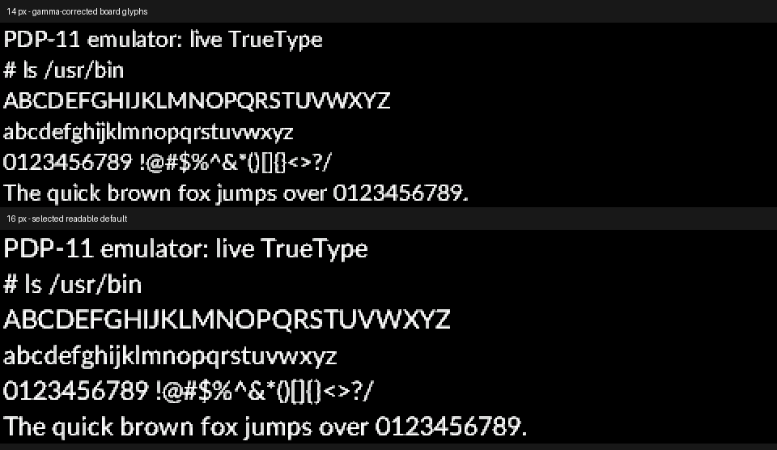

# Panel text readability, 2026-10-26

Both Pico families now use gamma-corrected text coverage and Terminal Sans
(derived from Lato Regular) at **16 pixels** for the `readable` setting.
Existing readable settings select the new size after a firmware update.
The compact setting remains 11 pixels; live `+` and `-` controls still work.

The rasterizer samples each pixel at 4 x 4 positions, then stores four
coverage levels in the existing 4 KB cache. Previously those levels became
RGB brightness 0, 85, 170 and 255. Treating coverage directly as a display
code made the partially covered strokes dark. The text lookup table now
encodes coverage with the sRGB transfer curve: **0, 156, 213 and 255**.
It uses the same RGB565 output and cache format, with no new RAM allocation
or floating-point work. Graphics pixels and LCD gamma registers are unchanged.
The panel response is assumed to be sRGB-like, rather than optically calibrated.

## Hardware comparison

The physical Pico W (RP2040, 200 MHz) and Pico 2 W (RP2350, 150 MHz) drove
their LAFVIN ST7796 panels at both 14 and 16 pixels. Native exports verify
identical glyph bytes, metrics and corrected RGB565 palettes on both chips.
The normal 14/16-pixel comparison reported zero panel errors, lost console
input and dropped clock ticks.

| Size | ASCII glyph-cache bytes | Line height | Rows on a 320-pixel-high panel |
|---|---:|---:|---:|
| 14 px | 3,113 | 19 px | 16 |
| **16 px** | **3,581** | **22 px** | **14** |

Sixteen pixels was selected from the captured rendering because lowercase
letters and punctuation have more distinct shapes. It trades two text rows
for larger characters and remains within the existing cache. Spacing still
uses the font's natural advances and bearings. TrueType hinting remains
unimplemented.



This image reconstructs the exported board glyphs using the exported RGB565
palette. It is not a photograph of the LCD; actual viewing conditions were
not measured. [Native metrics, palette and glyph hashes](font-2026-10-26.json).

Live font checks cover both faces at 14, 15 and 16 pixels, refusal of an
oversized cache request, and restoration of the original glyph data. One
initial extended Pico 2 stress run reported one dropped clock tick; a clean
boot and complete repeat passed with zero dropped ticks and zero lost input.

## Repeat

With the standard readable firmware on a leased board:

```text
py -3 tools/font_capture.py --port COM7 --out work/font2040 --exercise
py -3 tools/font_capture.py --port COM6 --out work/font2350 --exercise
```

The tool expects 16 pixels by default; `--size 14` captures an older or
temporarily resized 14-pixel font. `--exercise` returns to its starting size.
The `C` export line contains the firmware's 16 RGB565 lookup values; cached
coverage levels use entries 0, 5, 10 and 15. Older exports without this line
remain readable using their original linear brightness mapping.
